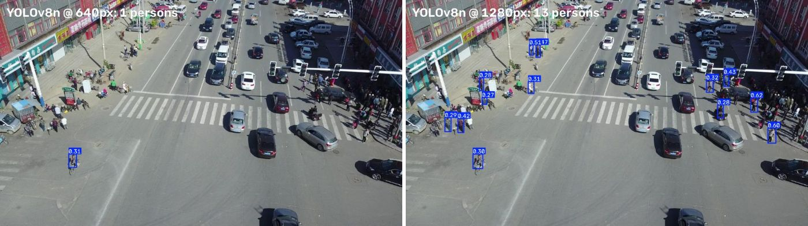
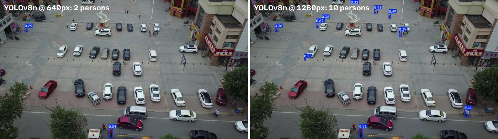
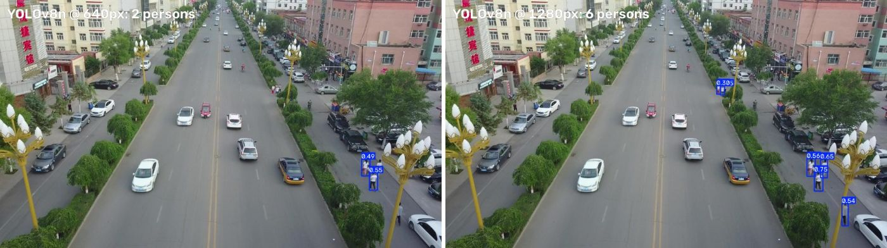

# RubbleSight – Post-Disaster Search and Rescue (Vision Baseline)

Public companion repository for my M.Tech dissertation at NSUT, New Delhi:
*"An Edge-AI Enabled UAV Framework Fusing Vision and RF Sensing for Detection of Visible and Buried Disaster Victims"*

## The problem

After an earthquake or building collapse, the first 72 hours decide survival. Rescue teams need to know quickly **where survivors are**, both the people visible on the surface and the people trapped under debris that no camera can see.

RubbleSight is a UAV framework that detects both kinds of victim:

| Component | What it detects | How | Status |
|---|---|---|---|
| **Line-of-sight (LOS)** | Visible victims on or around debris | RGB and thermal imaging with deep-learning person detection | Baseline in this repo |
| **Non-line-of-sight (NLOS)** | Victims buried under rubble | RF sensing (Wi-Fi and radar), which can pass through debris and pick up signs of life such as breathing motion or a victim's phone signals | In development (private) |
| **Fusion and edge deployment** | One combined victim map for rescuers | Combining LOS and NLOS evidence onboard the drone in real time | In development (private) |

This public repository contains the **LOS vision baseline** only. The NLOS and fusion components hold the dissertation's novel contribution, so they're developed privately and will be released after the dissertation is evaluated and published.

The work builds on published research, including PDSR, a post-disaster search-and-rescue UAV framework by Abdellatif et al. (IEEE IoT Magazine, 2025), and airborne UWB radar for vital-sign detection by Jing et al. (Sensors, 2025).

## Baseline results on real drone imagery

**Why VisDrone?** Large public datasets of drone footage over real disaster sites are scarce, and that scarcity is part of what this dissertation addresses. As a first benchmark, I used [VisDrone2019-DET](https://github.com/VisDrone/VisDrone-Dataset), the largest public dataset of people seen from drones. Its scenes are urban streets, not rubble, but it tests the core LOS challenge: people who are only a few pixels tall when seen from altitude. Disaster scenes add debris, dust, smoke and partial burial, so **real disaster performance is expected to be lower than these numbers**. Evaluation on disaster-specific data is the next step (see [roadmap](docs/roadmap.md)).

I evaluated off-the-shelf YOLOv8 models (pretrained on COCO, **no fine-tuning**) on the full VisDrone validation set: 548 drone images containing 13,969 labelled people (pedestrian + people classes). A detection counts as correct at IoU ≥ 0.5, confidence threshold 0.25.

| Model | Input size | Precision | Recall | F1 | CPU time / image |
|---|---|---|---|---|---|
| YOLOv8n | 640 | 0.801 | 0.073 | 0.134 | 70 ms |
| YOLOv8n | 1280 | 0.848 | 0.213 | 0.340 | 223 ms |
| YOLOv8s | 640 | 0.829 | 0.121 | 0.211 | 160 ms |
| YOLOv8s | 1280 | **0.858** | **0.266** | **0.406** | 598 ms |

*Timing measured on a 2-core CPU without a GPU; edge hardware with acceleration will be much faster.*

**What this shows**
- **Detections are reliable but most people are missed.** Precision stays above 80%, but even the best setup finds only about 27% of people. From drone altitude, people are only a few pixels tall, and COCO-trained models rarely see targets that small.
- **Input resolution matters more than model size.** Going from 640 to 1280 px roughly triples recall for YOLOv8n (7.3% → 21.3%), a bigger gain than switching to the larger YOLOv8s at 640.
- **There is a speed/accuracy trade-off for edge deployment.** Higher resolution and bigger models cost about 3–9× more compute per image.

These results motivate the next stages:
1. **Fine-tuning on aerial and thermal data.** Thermal imaging also helps at night and through light smoke, and it protects victims' privacy because faces aren't identifiable.
2. **Small-object techniques**, such as tiled inference, since resolution already proved to be the biggest lever.
3. **Evaluation on disaster-specific imagery** (collapsed buildings and debris).
4. **NLOS sensing.** Even a perfect camera model can't see victims buried under rubble. That gap is the reason RubbleSight adds RF sensing.

### Example detections (left: 640 px, right: 1280 px, YOLOv8n)





## Quick start

```bash
pip install -r requirements.txt

# Detect people in an image, video or folder
python src/vision/baseline_detect.py --source path/to/drone_image.jpg --save

# Reproduce the evaluation (download VisDrone2019-DET-val first)
python src/vision/eval_visdrone.py --data path/to/VisDrone2019-DET-val \
    --weights yolov8n.pt --imgsz 1280 --out results/yolov8n_1280.json
```

Raw metrics for each run are in [`results/`](results/).

## Structure
- `src/vision/baseline_detect.py` – person detection on images, video or webcam
- `src/vision/eval_visdrone.py` – precision/recall evaluation against VisDrone ground truth
- `results/` – metrics from each evaluation run
- `assets/` – example detection images
- `docs/roadmap.md` – project phases and status

## Tech stack
Python · PyTorch · Ultralytics YOLO · OpenCV · NumPy

## Author
Yashdeep, M.Tech IT, NSUT
