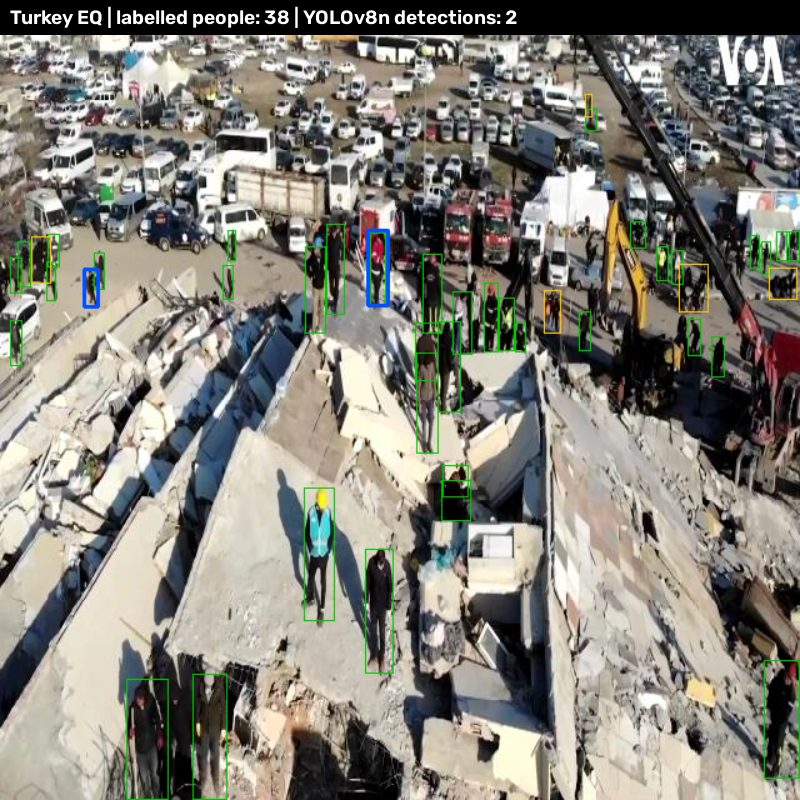
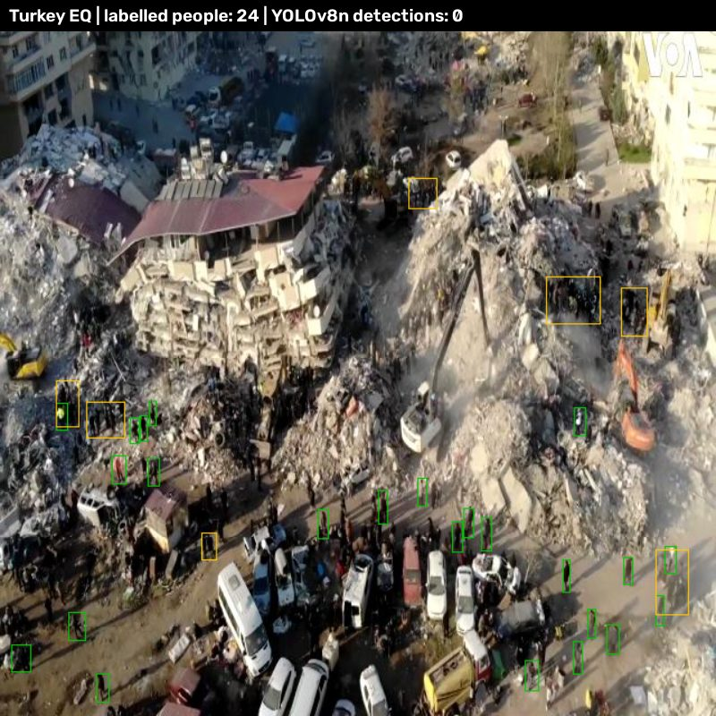

# RubbleSight – Post-Disaster Search and Rescue (Vision Baseline)

Public companion repository for my M.Tech dissertation at NSUT, New Delhi:
*"An Edge-AI Enabled UAV Framework Fusing Vision and RF Sensing for Detection of Visible and Buried Disaster Victims"*

## The problem

After an earthquake or building collapse, the first 72 hours decide survival. Rescue teams need to know quickly **where survivors are**, both the people visible on the surface and the people trapped under debris that no camera can see.

RubbleSight is a UAV framework that detects both kinds of victim:

| Component | What it detects | How | Status |
|---|---|---|---|
| **Line-of-sight (LOS)** | Visible victims on or around debris | RGB and thermal imaging with deep-learning person detection | Baseline in this repo |
| **Non-line-of-sight (NLOS)** | Victims buried under rubble | RF sensing (Wi-Fi and radar), which can pass through debris and pick up signs of life such as breathing motion or a victim's phone signals | In development (private) |
| **Fusion and edge deployment** | One combined victim map for rescuers | Combining LOS and NLOS evidence onboard the drone in real time | In development (private) |

This public repository contains the **LOS vision baseline** only. The NLOS and fusion components hold the dissertation's novel contribution, so they're developed privately and will be released after the dissertation is evaluated and published.

The work builds on published research, including PDSR, a post-disaster search-and-rescue UAV framework by Abdellatif et al. (IEEE IoT Magazine, 2025), and airborne UWB radar for vital-sign detection by Jing et al. (Sensors, 2025).

## Baseline results

I tested off-the-shelf YOLOv8 models (pretrained on COCO, **no fine-tuning**) on two kinds of real drone footage: an actual earthquake site, and a large general drone benchmark. A detection counts as correct at IoU ≥ 0.5, confidence threshold 0.25.

### 1. Real earthquake footage: Turkey 2023 (D-RespNeT)

[D-RespNeT](https://app.roboflow.com/cranfield-university-dwusz/phd-project-instance-segmentation/7) (Cranfield University, MIT licence) contains drone footage of collapsed buildings from the 2023 Turkey earthquake, labelled with 28 disaster classes. I used its validation and test splits: **75 images with 579 individually labelled people** (`civilian_visible` and `rescue_team`). Crowds labelled as one region (`group_of_civilians`) are ignored, so detections there are neither rewarded nor penalised.

| Model | Input size | Precision | Recall | F1 |
|---|---|---|---|---|
| YOLOv8n | 640 | 0.798 | 0.150 | 0.253 |
| YOLOv8n | 1280 | 0.687 | 0.159 | 0.258 |
| YOLOv8s | 640 | 0.800 | 0.131 | 0.226 |
| YOLOv8s | 1280 | 0.755 | 0.133 | 0.226 |

**What this shows**
- **A general-purpose detector misses about 85% of people at a real disaster site.** It even misses rescue workers who are clearly visible standing on rubble (first image below).
- **Neither a bigger model nor higher resolution helps here.** That points to a *domain gap*: rubble, dust, shadows, unusual poses and cluttered backgrounds that COCO-trained models never learned. The fix is training on disaster imagery, not just a larger model.
- **Caveats:** this is a small sample (75 images). The dataset's images are stored at 640 × 640 with contrast enhancement, which is why upscaling to 1280 adds no detail, and which may also affect a model trained on normal photos.




*Green = labelled people, blue = YOLOv8n detections, orange = crowd regions (ignored).*

### 2. General drone benchmark: VisDrone2019

[VisDrone2019-DET](https://github.com/VisDrone/VisDrone-Dataset) is the largest public dataset of people seen from drones. Its scenes are city streets, not rubble, but it tests the same core challenge at scale: people who are only a few pixels tall. I used the full validation set: **548 images with 13,969 labelled people**.

| Model | Input size | Precision | Recall | F1 | CPU time / image |
|---|---|---|---|---|---|
| YOLOv8n | 640 | 0.801 | 0.073 | 0.134 | 70 ms |
| YOLOv8n | 1280 | 0.848 | 0.213 | 0.340 | 223 ms |
| YOLOv8s | 640 | 0.829 | 0.121 | 0.211 | 160 ms |
| YOLOv8s | 1280 | **0.858** | **0.266** | **0.406** | 598 ms |

*Timing measured on a 2-core CPU without a GPU; edge hardware with acceleration will be much faster.*

- **Detections are reliable, but most people are missed:** precision stays above 80%, yet even the best setup finds only about 27% of people.
- **On native high-resolution footage, resolution is the biggest lever:** going from 640 to 1280 px roughly triples recall for YOLOv8n (7.3% → 21.3%).
- **There is a speed/accuracy trade-off for edge deployment:** higher resolution and bigger models cost about 3–9× more compute per image.


*Left: 640 px, right: 1280 px (YOLOv8n).*

### What comes next

1. **Fine-tuning on disaster imagery**, starting with D-RespNeT's training split, to close the domain gap shown above.
2. **Thermal imaging**, which helps at night and through light smoke and protects victims' privacy, because faces aren't identifiable.
3. **Small-object techniques**, such as tiled inference on native-resolution footage.
4. **NLOS sensing.** Even a perfect camera model can't see victims buried under rubble. That gap is the reason RubbleSight adds RF sensing.

## Quick start

```bash
pip install -r requirements.txt

# Detect people in an image, video or folder
python src/vision/baseline_detect.py --source path/to/drone_image.jpg --save

# Evaluate on Turkey earthquake footage (D-RespNeT YOLOv8 export)
python src/vision/eval_respnet.py --data "path/to/D_RespNeT - Instance Segmentation.v7i.yolov8" \
    --weights yolov8n.pt --imgsz 640 --out results/respnet_yolov8n_640.json

# Evaluate on VisDrone2019-DET-val
python src/vision/eval_visdrone.py --data path/to/VisDrone2019-DET-val \
    --weights yolov8n.pt --imgsz 1280 --out results/yolov8n_1280.json
```

Raw metrics for each run are in [`results/`](results/).

## Structure
- `src/vision/baseline_detect.py` – person detection on images, video or webcam
- `src/vision/eval_respnet.py` – precision/recall on real earthquake footage (D-RespNeT)
- `src/vision/eval_visdrone.py` – precision/recall on VisDrone
- `results/` – metrics from each evaluation run
- `assets/` – example detection images
- `docs/roadmap.md` – project phases and status

## Tech stack
Python · PyTorch · Ultralytics YOLO · OpenCV · NumPy

## Author
Yashdeep, M.Tech IT, NSUT
